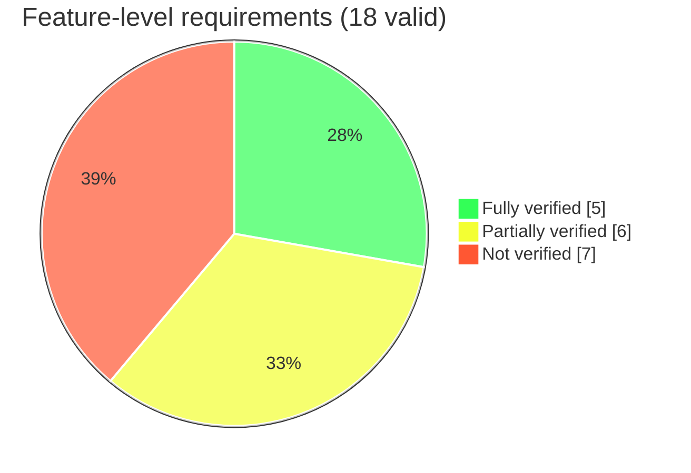
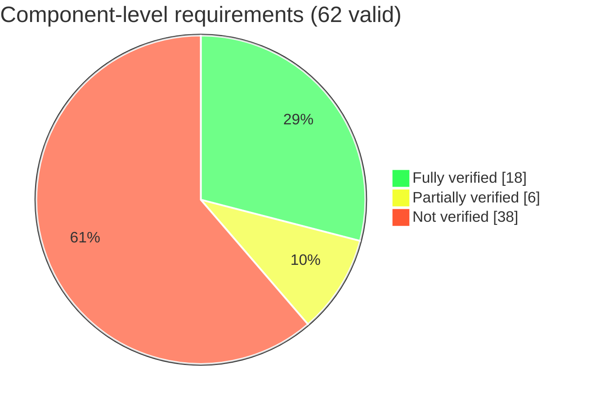

# Integration Test Coverage Report

_Generated: 2026-10-27_

This report reflects the current status of **integration test** coverage for the
Lifecycle **feature-level** requirements and the Launch Manager **component-level**
requirements. Only requirements with `:status: valid` are considered.

**Sources**

- Feature-level requirements: [Lifecycle feature requirements](https://eclipse-score.github.io/score/main/features/lifecycle/requirements/index.html) — 27 requirements, 18 `valid`.
- Component-level requirements: [Launch Manager component requirements](https://eclipse-score.github.io/lifecycle/main/components/launch_manager/requirements/requirements.html) — 78 requirements, 62 `valid`.
- Integration tests: [tests/integration/](https://github.com/eclipse-score/lifecycle/tree/main/tests/integration) — 27 Python test files, scanned for `fully_verifies` / `partially_verifies`.

Health Monitor component requirements are not considered; they currently contain only a placeholder
(`comp_req__health_monitor__dummy`).

---

## Methodology

Each integration test declares `fully_verifies=[...]` and `partially_verifies=[...]`
lists of requirement IDs.

**Component-level status** (per requirement):

- **Fully verified** — at least one test lists it in `fully_verifies`.
- **Partially verified** — no test fully verifies it, but at least one test lists it in `partially_verifies`.
- **Not verified** — no test references it.

**Feature-level status** combines *direct* verification (a test naming the `feat_req__*`
ID directly) with *derived* verification (the status of the `comp_req__*` requirements
that were `derived_from` the feature):

- **Fully verified** — all derived component requirements are fully verified, **or**
  a test directly fully verifies the feature and no derived component requirement is only partially verified.
- **Partially verified** — at least one derived component requirement is only partially verified,
  **or** a test directly verifies the feature only partially, **or** the derived component
  requirements are a mix of verified/unverified.
- **Not verified** — all derived component requirements are not verified **and** no test verifies the feature itself.

> Note: 4 features (`conditional_startup`, `run_target_support`, `termination_dependency`, `recovery_action_support`) are directly
> `fully_verifies`-annotated by a test but have a derived component requirement that is only
> *partially* verified, so per the rule above they are counted as **partially verified**.

---

## Summary Table

| Requirement level | Total (valid) | Not verified | Partially verified | Fully verified |
|---|---:|---:|---:|---:|
| **Feature-level requirements** | 18 | 7 | 6 | 5 |
| **Component-level requirements** | 62 | 38 | 6 | 18 |

| Integration tests | Count |
|---|---:|
| Total test files | 27 |
| Tests linking ≥1 requirement | 21 |
| Tests with no requirement link | 6 |

---

## Feature-Level Requirement Coverage

| Status | Count | Share |
|---|---:|---:|
| Fully verified | 5 | 27.8% |
| Partially verified | 6 | 33.3% |
| Not verified | 7 | 38.9% |

**Fully verified (5):** [`launch_support`](https://eclipse-score.github.io/score/main/features/lifecycle/requirements/index.html#feat_req__lifecycle__launch_support), [`process_ordering`](https://eclipse-score.github.io/score/main/features/lifecycle/requirements/index.html#feat_req__lifecycle__process_ordering), [`process_termination`](https://eclipse-score.github.io/score/main/features/lifecycle/requirements/index.html#feat_req__lifecycle__process_termination), [`control_commands`](https://eclipse-score.github.io/score/main/features/lifecycle/requirements/index.html#feat_req__lifecycle__control_commands), [`liveliness_detection`](https://eclipse-score.github.io/score/main/features/lifecycle/requirements/index.html#feat_req__lifecycle__liveliness_detection)

**Partially verified (6):** [`sandbox_options`](https://eclipse-score.github.io/score/main/features/lifecycle/requirements/index.html#feat_req__lifecycle__sandbox_options), [`conditional_startup`](https://eclipse-score.github.io/score/main/features/lifecycle/requirements/index.html#feat_req__lifecycle__conditional_startup), [`run_target_support`](https://eclipse-score.github.io/score/main/features/lifecycle/requirements/index.html#feat_req__lifecycle__run_target_support), [`termination_dependency`](https://eclipse-score.github.io/score/main/features/lifecycle/requirements/index.html#feat_req__lifecycle__termination_dependency), [`monitor_processes`](https://eclipse-score.github.io/score/main/features/lifecycle/requirements/index.html#feat_req__lifecycle__monitor_processes), [`recovery_action_support`](https://eclipse-score.github.io/score/main/features/lifecycle/requirements/index.html#feat_req__lifecycle__recovery_action_support)

**Not verified (7):** [`lm_self_health_check`](https://eclipse-score.github.io/score/main/features/lifecycle/requirements/index.html#feat_req__lifecycle__lm_self_health_check), [`prog_lang`](https://eclipse-score.github.io/score/main/features/lifecycle/requirements/index.html#feat_req__lifecycle__prog_lang), [`hm_deadline`](https://eclipse-score.github.io/score/main/features/lifecycle/requirements/index.html#feat_req__lifecycle__hm_deadline), [`hm_logical`](https://eclipse-score.github.io/score/main/features/lifecycle/requirements/index.html#feat_req__lifecycle__hm_logical), [`hm_checkpoint`](https://eclipse-score.github.io/score/main/features/lifecycle/requirements/index.html#feat_req__lifecycle__hm_checkpoint), [`logging_support`](https://eclipse-score.github.io/score/main/features/lifecycle/requirements/index.html#feat_req__lifecycle__logging_support), [`component_group_config`](https://eclipse-score.github.io/score/main/features/lifecycle/requirements/index.html#feat_req__lifecycle__component_group_config)

---

## Component-Level Requirement Coverage

| Status | Count | Share |
|---|---:|---:|
| Fully verified | 18 | 29.0% |
| Partially verified | 6 | 9.7% |
| Not verified | 38 | 61.3% |

**Fully verified (18):** [`launch_manager_shutdown`](https://eclipse-score.github.io/lifecycle/main/components/launch_manager/requirements/requirements.html#comp_req__launch_man__launch_manager_shutdown), [`rc_os_state`](https://eclipse-score.github.io/lifecycle/main/components/launch_manager/requirements/requirements.html#comp_req__launch_man__rc_os_state), [`rc_lifecycle`](https://eclipse-score.github.io/lifecycle/main/components/launch_manager/requirements/requirements.html#comp_req__launch_man__rc_lifecycle), [`process_launch_args`](https://eclipse-score.github.io/lifecycle/main/components/launch_manager/requirements/requirements.html#comp_req__launch_man__process_launch_args), [`uid_gid_support`](https://eclipse-score.github.io/lifecycle/main/components/launch_manager/requirements/requirements.html#comp_req__launch_man__uid_gid_support), [`launch_priority_support`](https://eclipse-score.github.io/lifecycle/main/components/launch_manager/requirements/requirements.html#comp_req__launch_man__launch_priority_support), [`cwd_support`](https://eclipse-score.github.io/lifecycle/main/components/launch_manager/requirements/requirements.html#comp_req__launch_man__cwd_support), [`retries_configurable`](https://eclipse-score.github.io/lifecycle/main/components/launch_manager/requirements/requirements.html#comp_req__launch_man__retries_configurable), [`supplementary_groups`](https://eclipse-score.github.io/lifecycle/main/components/launch_manager/requirements/requirements.html#comp_req__launch_man__supplementary_groups), [`scheduling_policy`](https://eclipse-score.github.io/lifecycle/main/components/launch_manager/requirements/requirements.html#comp_req__launch_man__scheduling_policy), [`runmask_support`](https://eclipse-score.github.io/lifecycle/main/components/launch_manager/requirements/requirements.html#comp_req__launch_man__runmask_support), [`launch_parallel`](https://eclipse-score.github.io/lifecycle/main/components/launch_manager/requirements/requirements.html#comp_req__launch_man__launch_parallel), [`shutdown_signal`](https://eclipse-score.github.io/lifecycle/main/components/launch_manager/requirements/requirements.html#comp_req__launch_man__shutdown_signal), [`rt_comp_dep`](https://eclipse-score.github.io/lifecycle/main/components/launch_manager/requirements/requirements.html#comp_req__launch_man__rt_comp_dep), [`rt_rt_dep`](https://eclipse-score.github.io/lifecycle/main/components/launch_manager/requirements/requirements.html#comp_req__launch_man__rt_rt_dep), [`process_state_comm`](https://eclipse-score.github.io/lifecycle/main/components/launch_manager/requirements/requirements.html#comp_req__launch_man__process_state_comm), [`switch_run_targets`](https://eclipse-score.github.io/lifecycle/main/components/launch_manager/requirements/requirements.html#comp_req__launch_man__switch_run_targets), [`ra_comp_switch_rt`](https://eclipse-score.github.io/lifecycle/main/components/launch_manager/requirements/requirements.html#comp_req__launch_man__ra_comp_switch_rt)

**Partially verified (6):** [`launcher_exit_shutdown`](https://eclipse-score.github.io/lifecycle/main/components/launch_manager/requirements/requirements.html#comp_req__launch_man__launcher_exit_shutdown), [`conf_of_comp_ready_cond`](https://eclipse-score.github.io/lifecycle/main/components/launch_manager/requirements/requirements.html#comp_req__launch_man__conf_of_comp_ready_cond), [`rc_file_state`](https://eclipse-score.github.io/lifecycle/main/components/launch_manager/requirements/requirements.html#comp_req__launch_man__rc_file_state), [`start_named_run_target`](https://eclipse-score.github.io/lifecycle/main/components/launch_manager/requirements/requirements.html#comp_req__launch_man__start_named_run_target), [`failure_detect`](https://eclipse-score.github.io/lifecycle/main/components/launch_manager/requirements/requirements.html#comp_req__launch_man__failure_detect), [`ra_comp_reactivate`](https://eclipse-score.github.io/lifecycle/main/components/launch_manager/requirements/requirements.html#comp_req__launch_man__ra_comp_reactivate)

**Not verified (38):** all remaining valid component requirements.

---

## Not Verified — Detailed Lists

### Not verified feature-level requirements (7)

| # | Feature requirement ID | Title |
|---:|---|---|
| 1 | [`feat_req__lifecycle__lm_self_health_check`](https://eclipse-score.github.io/score/main/features/lifecycle/requirements/index.html#feat_req__lifecycle__lm_self_health_check) | Launch manager self health check |
| 2 | [`feat_req__lifecycle__prog_lang`](https://eclipse-score.github.io/score/main/features/lifecycle/requirements/index.html#feat_req__lifecycle__prog_lang) | Lifecycle programming language support |
| 3 | [`feat_req__lifecycle__hm_deadline`](https://eclipse-score.github.io/score/main/features/lifecycle/requirements/index.html#feat_req__lifecycle__hm_deadline) | Health Monitor deadline supervision |
| 4 | [`feat_req__lifecycle__hm_logical`](https://eclipse-score.github.io/score/main/features/lifecycle/requirements/index.html#feat_req__lifecycle__hm_logical) | Health Monitor logical supervision |
| 5 | [`feat_req__lifecycle__hm_checkpoint`](https://eclipse-score.github.io/score/main/features/lifecycle/requirements/index.html#feat_req__lifecycle__hm_checkpoint) | Health Monitor checkpoint supervision |
| 6 | [`feat_req__lifecycle__logging_support`](https://eclipse-score.github.io/score/main/features/lifecycle/requirements/index.html#feat_req__lifecycle__logging_support) | Logging support |
| 7 | [`feat_req__lifecycle__component_group_config`](https://eclipse-score.github.io/score/main/features/lifecycle/requirements/index.html#feat_req__lifecycle__component_group_config) | Component grouping configuration |

### Not verified component-level requirements (38)

| # | Component requirement ID | Derived from (feature) |
|---:|---|---|
| 1 | [`comp_req__launch_man__consistent_dependencies`](https://eclipse-score.github.io/lifecycle/main/components/launch_manager/requirements/requirements.html#comp_req__launch_man__consistent_dependencies) | [`process_ordering`](https://eclipse-score.github.io/score/main/features/lifecycle/requirements/index.html#feat_req__lifecycle__process_ordering) |
| 2 | [`comp_req__launch_man__comp_activate_tout`](https://eclipse-score.github.io/lifecycle/main/components/launch_manager/requirements/requirements.html#comp_req__launch_man__comp_activate_tout) | [`conditional_startup`](https://eclipse-score.github.io/score/main/features/lifecycle/requirements/index.html#feat_req__lifecycle__conditional_startup) |
| 3 | [`comp_req__launch_man__stop_process_dependents`](https://eclipse-score.github.io/lifecycle/main/components/launch_manager/requirements/requirements.html#comp_req__launch_man__stop_process_dependents) | [`termination_dependency`](https://eclipse-score.github.io/score/main/features/lifecycle/requirements/index.html#feat_req__lifecycle__termination_dependency) |
| 4 | [`comp_req__launch_man__dep_based_startup_order`](https://eclipse-score.github.io/lifecycle/main/components/launch_manager/requirements/requirements.html#comp_req__launch_man__dep_based_startup_order) | [`conditional_startup`](https://eclipse-score.github.io/score/main/features/lifecycle/requirements/index.html#feat_req__lifecycle__conditional_startup) |
| 5 | [`comp_req__launch_man__lifecycle_lang_support`](https://eclipse-score.github.io/lifecycle/main/components/launch_manager/requirements/requirements.html#comp_req__launch_man__lifecycle_lang_support) | [`prog_lang`](https://eclipse-score.github.io/score/main/features/lifecycle/requirements/index.html#feat_req__lifecycle__prog_lang) |
| 6 | [`comp_req__launch_man__check_dependency_exec`](https://eclipse-score.github.io/lifecycle/main/components/launch_manager/requirements/requirements.html#comp_req__launch_man__check_dependency_exec) | [`conditional_startup`](https://eclipse-score.github.io/score/main/features/lifecycle/requirements/index.html#feat_req__lifecycle__conditional_startup) |
| 7 | [`comp_req__launch_man__define_swc_dependencies`](https://eclipse-score.github.io/lifecycle/main/components/launch_manager/requirements/requirements.html#comp_req__launch_man__define_swc_dependencies) | [`conditional_startup`](https://eclipse-score.github.io/score/main/features/lifecycle/requirements/index.html#feat_req__lifecycle__conditional_startup) |
| 8 | [`comp_req__launch_man__terminal_support`](https://eclipse-score.github.io/lifecycle/main/components/launch_manager/requirements/requirements.html#comp_req__launch_man__terminal_support) | [`sandbox_options`](https://eclipse-score.github.io/score/main/features/lifecycle/requirements/index.html#feat_req__lifecycle__sandbox_options) |
| 9 | [`comp_req__launch_man__std_handle_redir`](https://eclipse-score.github.io/lifecycle/main/components/launch_manager/requirements/requirements.html#comp_req__launch_man__std_handle_redir) | [`sandbox_options`](https://eclipse-score.github.io/score/main/features/lifecycle/requirements/index.html#feat_req__lifecycle__sandbox_options) |
| 10 | [`comp_req__launch_man__secpol_non_root`](https://eclipse-score.github.io/lifecycle/main/components/launch_manager/requirements/requirements.html#comp_req__launch_man__secpol_non_root) | [`sandbox_options`](https://eclipse-score.github.io/score/main/features/lifecycle/requirements/index.html#feat_req__lifecycle__sandbox_options) |
| 11 | [`comp_req__launch_man__capability_support`](https://eclipse-score.github.io/lifecycle/main/components/launch_manager/requirements/requirements.html#comp_req__launch_man__capability_support) | [`sandbox_options`](https://eclipse-score.github.io/score/main/features/lifecycle/requirements/index.html#feat_req__lifecycle__sandbox_options) |
| 12 | [`comp_req__launch_man__fd_inheritance`](https://eclipse-score.github.io/lifecycle/main/components/launch_manager/requirements/requirements.html#comp_req__launch_man__fd_inheritance) | [`sandbox_options`](https://eclipse-score.github.io/score/main/features/lifecycle/requirements/index.html#feat_req__lifecycle__sandbox_options) |
| 13 | [`comp_req__launch_man__support_secpol_type`](https://eclipse-score.github.io/lifecycle/main/components/launch_manager/requirements/requirements.html#comp_req__launch_man__support_secpol_type) | [`sandbox_options`](https://eclipse-score.github.io/score/main/features/lifecycle/requirements/index.html#feat_req__lifecycle__sandbox_options) |
| 14 | [`comp_req__launch_man__aslr_support`](https://eclipse-score.github.io/lifecycle/main/components/launch_manager/requirements/requirements.html#comp_req__launch_man__aslr_support) | [`sandbox_options`](https://eclipse-score.github.io/score/main/features/lifecycle/requirements/index.html#feat_req__lifecycle__sandbox_options) |
| 15 | [`comp_req__launch_man__process_rlimit_support`](https://eclipse-score.github.io/lifecycle/main/components/launch_manager/requirements/requirements.html#comp_req__launch_man__process_rlimit_support) | [`sandbox_options`](https://eclipse-score.github.io/score/main/features/lifecycle/requirements/index.html#feat_req__lifecycle__sandbox_options) |
| 16 | [`comp_req__launch_man__configurable_timeout`](https://eclipse-score.github.io/lifecycle/main/components/launch_manager/requirements/requirements.html#comp_req__launch_man__configurable_timeout) | [`process_termination`](https://eclipse-score.github.io/score/main/features/lifecycle/requirements/index.html#feat_req__lifecycle__process_termination) |
| 17 | [`comp_req__launch_man__time_to_wait_config`](https://eclipse-score.github.io/lifecycle/main/components/launch_manager/requirements/requirements.html#comp_req__launch_man__time_to_wait_config) | [`process_termination`](https://eclipse-score.github.io/score/main/features/lifecycle/requirements/index.html#feat_req__lifecycle__process_termination) |
| 18 | [`comp_req__launch_man__rt_activate_tout`](https://eclipse-score.github.io/lifecycle/main/components/launch_manager/requirements/requirements.html#comp_req__launch_man__rt_activate_tout) | [`conditional_startup`](https://eclipse-score.github.io/score/main/features/lifecycle/requirements/index.html#feat_req__lifecycle__conditional_startup) |
| 19 | [`comp_req__launch_man__queue_rt_selection`](https://eclipse-score.github.io/lifecycle/main/components/launch_manager/requirements/requirements.html#comp_req__launch_man__queue_rt_selection) | [`control_commands`](https://eclipse-score.github.io/score/main/features/lifecycle/requirements/index.html#feat_req__lifecycle__control_commands) |
| 20 | [`comp_req__launch_man__force_rt_selection`](https://eclipse-score.github.io/lifecycle/main/components/launch_manager/requirements/requirements.html#comp_req__launch_man__force_rt_selection) | [`control_commands`](https://eclipse-score.github.io/score/main/features/lifecycle/requirements/index.html#feat_req__lifecycle__control_commands) |
| 21 | [`comp_req__launch_man__alive_failure`](https://eclipse-score.github.io/lifecycle/main/components/launch_manager/requirements/requirements.html#comp_req__launch_man__alive_failure) | [`monitor_processes`](https://eclipse-score.github.io/score/main/features/lifecycle/requirements/index.html#feat_req__lifecycle__monitor_processes) |
| 22 | [`comp_req__launch_man__ra_comp_failure_switch`](https://eclipse-score.github.io/lifecycle/main/components/launch_manager/requirements/requirements.html#comp_req__launch_man__ra_comp_failure_switch) | [`recovery_action_support`](https://eclipse-score.github.io/score/main/features/lifecycle/requirements/index.html#feat_req__lifecycle__recovery_action_support) |
| 23 | [`comp_req__launch_man__ra_comp_failed_esc`](https://eclipse-score.github.io/lifecycle/main/components/launch_manager/requirements/requirements.html#comp_req__launch_man__ra_comp_failed_esc) | [`recovery_action_support`](https://eclipse-score.github.io/score/main/features/lifecycle/requirements/index.html#feat_req__lifecycle__recovery_action_support) |
| 24 | [`comp_req__launch_man__ra_rt_cancel_trans`](https://eclipse-score.github.io/lifecycle/main/components/launch_manager/requirements/requirements.html#comp_req__launch_man__ra_rt_cancel_trans) | [`recovery_action_support`](https://eclipse-score.github.io/score/main/features/lifecycle/requirements/index.html#feat_req__lifecycle__recovery_action_support) |
| 25 | [`comp_req__launch_man__report_liveliness`](https://eclipse-score.github.io/lifecycle/main/components/launch_manager/requirements/requirements.html#comp_req__launch_man__report_liveliness) | [`liveliness_detection`](https://eclipse-score.github.io/score/main/features/lifecycle/requirements/index.html#feat_req__lifecycle__liveliness_detection) |
| 26 | [`comp_req__launch_man__report_lang_support`](https://eclipse-score.github.io/lifecycle/main/components/launch_manager/requirements/requirements.html#comp_req__launch_man__report_lang_support) | [`prog_lang`](https://eclipse-score.github.io/score/main/features/lifecycle/requirements/index.html#feat_req__lifecycle__prog_lang) |
| 27 | [`comp_req__launch_man__ra_rt_sm_notify`](https://eclipse-score.github.io/lifecycle/main/components/launch_manager/requirements/requirements.html#comp_req__launch_man__ra_rt_sm_notify) | [`recovery_action_support`](https://eclipse-score.github.io/score/main/features/lifecycle/requirements/index.html#feat_req__lifecycle__recovery_action_support) |
| 28 | [`comp_req__launch_man__ra_rt_failed_esc`](https://eclipse-score.github.io/lifecycle/main/components/launch_manager/requirements/requirements.html#comp_req__launch_man__ra_rt_failed_esc) | [`recovery_action_support`](https://eclipse-score.github.io/score/main/features/lifecycle/requirements/index.html#feat_req__lifecycle__recovery_action_support) |
| 29 | [`comp_req__launch_man__ra_rt_switch_rt`](https://eclipse-score.github.io/lifecycle/main/components/launch_manager/requirements/requirements.html#comp_req__launch_man__ra_rt_switch_rt) | [`recovery_action_support`](https://eclipse-score.github.io/score/main/features/lifecycle/requirements/index.html#feat_req__lifecycle__recovery_action_support) |
| 30 | [`comp_req__launch_man__lm_ext_watchdog_notify`](https://eclipse-score.github.io/lifecycle/main/components/launch_manager/requirements/requirements.html#comp_req__launch_man__lm_ext_watchdog_notify) | [`lm_self_health_check`](https://eclipse-score.github.io/score/main/features/lifecycle/requirements/index.html#feat_req__lifecycle__lm_self_health_check) |
| 31 | [`comp_req__launch_man__lm_ext_wdg_failed_test`](https://eclipse-score.github.io/lifecycle/main/components/launch_manager/requirements/requirements.html#comp_req__launch_man__lm_ext_wdg_failed_test) | [`lm_self_health_check`](https://eclipse-score.github.io/score/main/features/lifecycle/requirements/index.html#feat_req__lifecycle__lm_self_health_check) |
| 32 | [`comp_req__launch_man__lm_ext_watchdog_cfg`](https://eclipse-score.github.io/lifecycle/main/components/launch_manager/requirements/requirements.html#comp_req__launch_man__lm_ext_watchdog_cfg) | [`lm_self_health_check`](https://eclipse-score.github.io/score/main/features/lifecycle/requirements/index.html#feat_req__lifecycle__lm_self_health_check) |
| 33 | [`comp_req__launch_man__slog2_logging`](https://eclipse-score.github.io/lifecycle/main/components/launch_manager/requirements/requirements.html#comp_req__launch_man__slog2_logging) | [`logging_support`](https://eclipse-score.github.io/score/main/features/lifecycle/requirements/index.html#feat_req__lifecycle__logging_support) |
| 34 | [`comp_req__launch_man__process_logging_support`](https://eclipse-score.github.io/lifecycle/main/components/launch_manager/requirements/requirements.html#comp_req__launch_man__process_logging_support) | [`logging_support`](https://eclipse-score.github.io/score/main/features/lifecycle/requirements/index.html#feat_req__lifecycle__logging_support) |
| 35 | [`comp_req__launch_man__log_timestamp`](https://eclipse-score.github.io/lifecycle/main/components/launch_manager/requirements/requirements.html#comp_req__launch_man__log_timestamp) | [`logging_support`](https://eclipse-score.github.io/score/main/features/lifecycle/requirements/index.html#feat_req__lifecycle__logging_support) |
| 36 | [`comp_req__launch_man__dag_logging_controlif`](https://eclipse-score.github.io/lifecycle/main/components/launch_manager/requirements/requirements.html#comp_req__launch_man__dag_logging_controlif) | [`logging_support`](https://eclipse-score.github.io/score/main/features/lifecycle/requirements/index.html#feat_req__lifecycle__logging_support) |
| 37 | [`comp_req__launch_man__central_default_defines`](https://eclipse-score.github.io/lifecycle/main/components/launch_manager/requirements/requirements.html#comp_req__launch_man__central_default_defines) | [`component_group_config`](https://eclipse-score.github.io/score/main/features/lifecycle/requirements/index.html#feat_req__lifecycle__component_group_config) |
| 38 | [`comp_req__launch_man__lazy_check`](https://eclipse-score.github.io/lifecycle/main/components/launch_manager/requirements/requirements.html#comp_req__launch_man__lazy_check) | [`component_group_config`](https://eclipse-score.github.io/score/main/features/lifecycle/requirements/index.html#feat_req__lifecycle__component_group_config) |

### Integration tests that do not link any requirement (6)

| # | Test file |
|---:|---|
| 1 | [complex_monitoring](https://github.com/eclipse-score/lifecycle/blob/main/tests/integration/complex_monitoring/complex_monitoring.py) |
| 2 | [explicit_fallback_request](https://github.com/eclipse-score/lifecycle/blob/main/tests/integration/explicit_fallback_request/explicit_fallback_request.py) |
| 3 | [run_target_requests/already_active_run_target](https://github.com/eclipse-score/lifecycle/blob/main/tests/integration/run_target_requests/already_active_run_target/already_active_run_target.py) |
| 4 | [run_target_requests/replaced_activation](https://github.com/eclipse-score/lifecycle/blob/main/tests/integration/run_target_requests/replaced_activation/replaced_activation.py) |
| 5 | [run_target_requests/same_run_target_in_transition](https://github.com/eclipse-score/lifecycle/blob/main/tests/integration/run_target_requests/same_run_target_in_transition/same_run_target_in_transition.py) |
| 6 | [run_target_requests/unknown_run_target](https://github.com/eclipse-score/lifecycle/blob/main/tests/integration/run_target_requests/unknown_run_target/unknown_run_target.py) |

---

## Appendix A — Test → Requirement mapping

| Test file | Fully verifies | Partially verifies |
|---|---|---|
| [crash_ignores_dependents](https://github.com/eclipse-score/lifecycle/blob/main/tests/integration/crash_ignores_dependents/crash_ignores_dependents.py) | — | [`comp__failure_detect`](https://eclipse-score.github.io/lifecycle/main/components/launch_manager/requirements/requirements.html#comp_req__launch_man__failure_detect) |
| [crash_on_startup](https://github.com/eclipse-score/lifecycle/blob/main/tests/integration/crash_on_startup/crash_on_startup.py) | [`comp__retries_configurable`](https://eclipse-score.github.io/lifecycle/main/components/launch_manager/requirements/requirements.html#comp_req__launch_man__retries_configurable) | [`feat__monitor_processes`](https://eclipse-score.github.io/score/main/features/lifecycle/requirements/index.html#feat_req__lifecycle__monitor_processes), [`feat__recovery_action_support`](https://eclipse-score.github.io/score/main/features/lifecycle/requirements/index.html#feat_req__lifecycle__recovery_action_support), [`comp__failure_detect`](https://eclipse-score.github.io/lifecycle/main/components/launch_manager/requirements/requirements.html#comp_req__launch_man__failure_detect), [`comp__ra_comp_reactivate`](https://eclipse-score.github.io/lifecycle/main/components/launch_manager/requirements/requirements.html#comp_req__launch_man__ra_comp_reactivate) |
| [fallback_to_same_target_restarts](https://github.com/eclipse-score/lifecycle/blob/main/tests/integration/fallback_to_same_target_restarts/fallback_to_same_target_restarts.py) | [`comp__rc_lifecycle`](https://eclipse-score.github.io/lifecycle/main/components/launch_manager/requirements/requirements.html#comp_req__launch_man__rc_lifecycle), [`comp__rt_comp_dep`](https://eclipse-score.github.io/lifecycle/main/components/launch_manager/requirements/requirements.html#comp_req__launch_man__rt_comp_dep) | [`comp__process_launch_args`](https://eclipse-score.github.io/lifecycle/main/components/launch_manager/requirements/requirements.html#comp_req__launch_man__process_launch_args) |
| [incorrect_config_non_reporting](https://github.com/eclipse-score/lifecycle/blob/main/tests/integration/incorrect_config_non_reporting/test_incorrect_config_non_reporting.py) | — | [`comp__rc_lifecycle`](https://eclipse-score.github.io/lifecycle/main/components/launch_manager/requirements/requirements.html#comp_req__launch_man__rc_lifecycle) |
| [lm_shutdown_during_rt_switch](https://github.com/eclipse-score/lifecycle/blob/main/tests/integration/lm_shutdown_during_rt_switch/lm_shutdown_during_rt_switch.py) | — | [`feat__termination_dependency`](https://eclipse-score.github.io/score/main/features/lifecycle/requirements/index.html#feat_req__lifecycle__termination_dependency), [`comp__launcher_exit_shutdown`](https://eclipse-score.github.io/lifecycle/main/components/launch_manager/requirements/requirements.html#comp_req__launch_man__launcher_exit_shutdown) |
| [lm_shutdown_during_switch_to_off](https://github.com/eclipse-score/lifecycle/blob/main/tests/integration/lm_shutdown_during_switch_to_off/lm_shutdown_during_switch_to_off.py) | — | [`feat__termination_dependency`](https://eclipse-score.github.io/score/main/features/lifecycle/requirements/index.html#feat_req__lifecycle__termination_dependency), [`comp__launcher_exit_shutdown`](https://eclipse-score.github.io/lifecycle/main/components/launch_manager/requirements/requirements.html#comp_req__launch_man__launcher_exit_shutdown) |
| [parallel_launch](https://github.com/eclipse-score/lifecycle/blob/main/tests/integration/parallel_launch/parallel_launch.py) | [`comp__launch_parallel`](https://eclipse-score.github.io/lifecycle/main/components/launch_manager/requirements/requirements.html#comp_req__launch_man__launch_parallel) | [`feat__launch_support`](https://eclipse-score.github.io/score/main/features/lifecycle/requirements/index.html#feat_req__lifecycle__launch_support) |
| [process_complex_rep_failure](https://github.com/eclipse-score/lifecycle/blob/main/tests/integration/process_complex_rep_failure/process_complex_rep_failure.py) | — | [`comp__rc_lifecycle`](https://eclipse-score.github.io/lifecycle/main/components/launch_manager/requirements/requirements.html#comp_req__launch_man__rc_lifecycle), [`comp__ra_comp_switch_rt`](https://eclipse-score.github.io/lifecycle/main/components/launch_manager/requirements/requirements.html#comp_req__launch_man__ra_comp_switch_rt), [`comp__failure_detect`](https://eclipse-score.github.io/lifecycle/main/components/launch_manager/requirements/requirements.html#comp_req__launch_man__failure_detect), [`feat__recovery_action_support`](https://eclipse-score.github.io/score/main/features/lifecycle/requirements/index.html#feat_req__lifecycle__recovery_action_support) |
| [process_crash_monitoring](https://github.com/eclipse-score/lifecycle/blob/main/tests/integration/process_crash_monitoring/process_crash_monitoring.py) | — | [`comp__ra_comp_switch_rt`](https://eclipse-score.github.io/lifecycle/main/components/launch_manager/requirements/requirements.html#comp_req__launch_man__ra_comp_switch_rt), [`comp__failure_detect`](https://eclipse-score.github.io/lifecycle/main/components/launch_manager/requirements/requirements.html#comp_req__launch_man__failure_detect), [`feat__monitor_processes`](https://eclipse-score.github.io/score/main/features/lifecycle/requirements/index.html#feat_req__lifecycle__monitor_processes) |
| [process_fd_leak](https://github.com/eclipse-score/lifecycle/blob/main/tests/integration/process_fd_leak/process_fd_leak.py) | — | [`comp__rc_lifecycle`](https://eclipse-score.github.io/lifecycle/main/components/launch_manager/requirements/requirements.html#comp_req__launch_man__rc_lifecycle), [`comp__rc_os_state`](https://eclipse-score.github.io/lifecycle/main/components/launch_manager/requirements/requirements.html#comp_req__launch_man__rc_os_state) |
| [process_launch_args](https://github.com/eclipse-score/lifecycle/blob/main/tests/integration/process_launch_args/process_launch_args.py) | [`comp__process_launch_args`](https://eclipse-score.github.io/lifecycle/main/components/launch_manager/requirements/requirements.html#comp_req__launch_man__process_launch_args) | [`feat__launch_support`](https://eclipse-score.github.io/score/main/features/lifecycle/requirements/index.html#feat_req__lifecycle__launch_support) |
| [process_simple_rep_failure](https://github.com/eclipse-score/lifecycle/blob/main/tests/integration/process_simple_rep_failure/process_simple_rep_failure.py) | [`feat__recovery_action_support`](https://eclipse-score.github.io/score/main/features/lifecycle/requirements/index.html#feat_req__lifecycle__recovery_action_support), [`feat__liveliness_detection`](https://eclipse-score.github.io/score/main/features/lifecycle/requirements/index.html#feat_req__lifecycle__liveliness_detection), [`comp__ra_comp_switch_rt`](https://eclipse-score.github.io/lifecycle/main/components/launch_manager/requirements/requirements.html#comp_req__launch_man__ra_comp_switch_rt), [`comp__rc_lifecycle`](https://eclipse-score.github.io/lifecycle/main/components/launch_manager/requirements/requirements.html#comp_req__launch_man__rc_lifecycle), [`comp__rc_os_state`](https://eclipse-score.github.io/lifecycle/main/components/launch_manager/requirements/requirements.html#comp_req__launch_man__rc_os_state), [`comp__rt_comp_dep`](https://eclipse-score.github.io/lifecycle/main/components/launch_manager/requirements/requirements.html#comp_req__launch_man__rt_comp_dep) | [`comp__process_launch_args`](https://eclipse-score.github.io/lifecycle/main/components/launch_manager/requirements/requirements.html#comp_req__launch_man__process_launch_args), [`comp__failure_detect`](https://eclipse-score.github.io/lifecycle/main/components/launch_manager/requirements/requirements.html#comp_req__launch_man__failure_detect) |
| [process_wrong_binary_failure](https://github.com/eclipse-score/lifecycle/blob/main/tests/integration/process_wrong_binary_failure/process_wrong_binary_failure.py) | — | [`feat__launch_support`](https://eclipse-score.github.io/score/main/features/lifecycle/requirements/index.html#feat_req__lifecycle__launch_support) |
| [ready_conditions/.../exists](https://github.com/eclipse-score/lifecycle/blob/main/tests/integration/ready_conditions/file_state/exists/ready_condition_file.py) | — | [`comp__rc_file_state`](https://eclipse-score.github.io/lifecycle/main/components/launch_manager/requirements/requirements.html#comp_req__launch_man__rc_file_state), [`feat__conditional_startup`](https://eclipse-score.github.io/score/main/features/lifecycle/requirements/index.html#feat_req__lifecycle__conditional_startup) |
| [ready_conditions/.../not_existing](https://github.com/eclipse-score/lifecycle/blob/main/tests/integration/ready_conditions/file_state/not_existing/ready_condition_file_not_existing.py) | — | [`comp__rc_file_state`](https://eclipse-score.github.io/lifecycle/main/components/launch_manager/requirements/requirements.html#comp_req__launch_man__rc_file_state), [`feat__conditional_startup`](https://eclipse-score.github.io/score/main/features/lifecycle/requirements/index.html#feat_req__lifecycle__conditional_startup) |
| [ready_conditions/.../kterminated](https://github.com/eclipse-score/lifecycle/blob/main/tests/integration/ready_conditions/process_state/kterminated/kterminated.py) | — | [`comp__conf_of_comp_ready_cond`](https://eclipse-score.github.io/lifecycle/main/components/launch_manager/requirements/requirements.html#comp_req__launch_man__conf_of_comp_ready_cond), [`feat__conditional_startup`](https://eclipse-score.github.io/score/main/features/lifecycle/requirements/index.html#feat_req__lifecycle__conditional_startup) |
| [rt_running_when_process_exits](https://github.com/eclipse-score/lifecycle/blob/main/tests/integration/rt_running_when_process_exits/rt_running_when_process_exits.py) | — | [`feat__launch_support`](https://eclipse-score.github.io/score/main/features/lifecycle/requirements/index.html#feat_req__lifecycle__launch_support), [`feat__process_ordering`](https://eclipse-score.github.io/score/main/features/lifecycle/requirements/index.html#feat_req__lifecycle__process_ordering), [`comp__process_state_comm`](https://eclipse-score.github.io/lifecycle/main/components/launch_manager/requirements/requirements.html#comp_req__launch_man__process_state_comm) |
| [sandbox_options](https://github.com/eclipse-score/lifecycle/blob/main/tests/integration/sandbox_options/sandbox_options.py) | [`comp__uid_gid_support`](https://eclipse-score.github.io/lifecycle/main/components/launch_manager/requirements/requirements.html#comp_req__launch_man__uid_gid_support), [`comp__launch_priority_support`](https://eclipse-score.github.io/lifecycle/main/components/launch_manager/requirements/requirements.html#comp_req__launch_man__launch_priority_support), [`comp__scheduling_policy`](https://eclipse-score.github.io/lifecycle/main/components/launch_manager/requirements/requirements.html#comp_req__launch_man__scheduling_policy), [`comp__cwd_support`](https://eclipse-score.github.io/lifecycle/main/components/launch_manager/requirements/requirements.html#comp_req__launch_man__cwd_support), [`comp__supplementary_groups`](https://eclipse-score.github.io/lifecycle/main/components/launch_manager/requirements/requirements.html#comp_req__launch_man__supplementary_groups), [`comp__rc_os_state`](https://eclipse-score.github.io/lifecycle/main/components/launch_manager/requirements/requirements.html#comp_req__launch_man__rc_os_state), [`comp__rt_comp_dep`](https://eclipse-score.github.io/lifecycle/main/components/launch_manager/requirements/requirements.html#comp_req__launch_man__rt_comp_dep), [`comp__runmask_support`](https://eclipse-score.github.io/lifecycle/main/components/launch_manager/requirements/requirements.html#comp_req__launch_man__runmask_support) | [`comp__process_launch_args`](https://eclipse-score.github.io/lifecycle/main/components/launch_manager/requirements/requirements.html#comp_req__launch_man__process_launch_args) |
| [shutdown_signal](https://github.com/eclipse-score/lifecycle/blob/main/tests/integration/shutdown_signal/shutdown_signal.py) | [`feat__process_termination`](https://eclipse-score.github.io/score/main/features/lifecycle/requirements/index.html#feat_req__lifecycle__process_termination), [`comp__shutdown_signal`](https://eclipse-score.github.io/lifecycle/main/components/launch_manager/requirements/requirements.html#comp_req__launch_man__shutdown_signal) | — |
| [smoke](https://github.com/eclipse-score/lifecycle/blob/main/tests/integration/smoke/smoke.py) | — | [`feat__launch_support`](https://eclipse-score.github.io/score/main/features/lifecycle/requirements/index.html#feat_req__lifecycle__launch_support), [`feat__run_target_support`](https://eclipse-score.github.io/score/main/features/lifecycle/requirements/index.html#feat_req__lifecycle__run_target_support), [`comp__start_named_run_target`](https://eclipse-score.github.io/lifecycle/main/components/launch_manager/requirements/requirements.html#comp_req__launch_man__start_named_run_target), [`comp__switch_run_targets`](https://eclipse-score.github.io/lifecycle/main/components/launch_manager/requirements/requirements.html#comp_req__launch_man__switch_run_targets) |
| [switch_run_target](https://github.com/eclipse-score/lifecycle/blob/main/tests/integration/switch_run_target/switch_run_target.py) | [`feat__conditional_startup`](https://eclipse-score.github.io/score/main/features/lifecycle/requirements/index.html#feat_req__lifecycle__conditional_startup), [`feat__control_commands`](https://eclipse-score.github.io/score/main/features/lifecycle/requirements/index.html#feat_req__lifecycle__control_commands), [`feat__process_ordering`](https://eclipse-score.github.io/score/main/features/lifecycle/requirements/index.html#feat_req__lifecycle__process_ordering), [`feat__process_termination`](https://eclipse-score.github.io/score/main/features/lifecycle/requirements/index.html#feat_req__lifecycle__process_termination), [`feat__run_target_support`](https://eclipse-score.github.io/score/main/features/lifecycle/requirements/index.html#feat_req__lifecycle__run_target_support), [`feat__termination_dependency`](https://eclipse-score.github.io/score/main/features/lifecycle/requirements/index.html#feat_req__lifecycle__termination_dependency), [`comp__switch_run_targets`](https://eclipse-score.github.io/lifecycle/main/components/launch_manager/requirements/requirements.html#comp_req__launch_man__switch_run_targets), [`comp__launch_manager_shutdown`](https://eclipse-score.github.io/lifecycle/main/components/launch_manager/requirements/requirements.html#comp_req__launch_man__launch_manager_shutdown), [`comp__process_state_comm`](https://eclipse-score.github.io/lifecycle/main/components/launch_manager/requirements/requirements.html#comp_req__launch_man__process_state_comm), [`comp__rt_rt_dep`](https://eclipse-score.github.io/lifecycle/main/components/launch_manager/requirements/requirements.html#comp_req__launch_man__rt_rt_dep), [`comp__rt_comp_dep`](https://eclipse-score.github.io/lifecycle/main/components/launch_manager/requirements/requirements.html#comp_req__launch_man__rt_comp_dep) | [`comp__process_launch_args`](https://eclipse-score.github.io/lifecycle/main/components/launch_manager/requirements/requirements.html#comp_req__launch_man__process_launch_args) |
| [complex_monitoring](https://github.com/eclipse-score/lifecycle/blob/main/tests/integration/complex_monitoring/complex_monitoring.py) | — | — |
| [explicit_fallback_request](https://github.com/eclipse-score/lifecycle/blob/main/tests/integration/explicit_fallback_request/explicit_fallback_request.py) | — | — |
| [run_target_requests/already_active_run_target](https://github.com/eclipse-score/lifecycle/blob/main/tests/integration/run_target_requests/already_active_run_target/already_active_run_target.py) | — | — |
| [run_target_requests/replaced_activation](https://github.com/eclipse-score/lifecycle/blob/main/tests/integration/run_target_requests/replaced_activation/replaced_activation.py) | — | — |
| [run_target_requests/same_run_target_in_transition](https://github.com/eclipse-score/lifecycle/blob/main/tests/integration/run_target_requests/same_run_target_in_transition/same_run_target_in_transition.py) | — | — |
| [run_target_requests/unknown_run_target](https://github.com/eclipse-score/lifecycle/blob/main/tests/integration/run_target_requests/unknown_run_target/unknown_run_target.py) | — | — |

_(IDs abbreviated: `feat__` = `feat_req__lifecycle__`, `comp__` = `comp_req__launch_man__`.)_

---

## Appendix B — Features directly fully verified by a test *and* having derived component requirements

These feature requirements are named in a test's `fully_verifies` list, yet they also have
component requirements `derived_from` them. They are the cases where the feature-level status
depends on the interplay between the direct test annotation and the derived component coverage
(see the Methodology note about `conditional_startup`, `run_target_support`, `termination_dependency`, `recovery_action_support`).

| Feature requirement | Verifying test (`fully_verifies`) | Derived component requirements (status) |
|---|---|---|
| [`feat_req__lifecycle__process_ordering`](https://eclipse-score.github.io/score/main/features/lifecycle/requirements/index.html#feat_req__lifecycle__process_ordering) | [switch_run_target](https://github.com/eclipse-score/lifecycle/blob/main/tests/integration/switch_run_target/switch_run_target.py) | [`consistent_dependencies`](https://eclipse-score.github.io/lifecycle/main/components/launch_manager/requirements/requirements.html#comp_req__launch_man__consistent_dependencies) (not verified), [`process_state_comm`](https://eclipse-score.github.io/lifecycle/main/components/launch_manager/requirements/requirements.html#comp_req__launch_man__process_state_comm) (fully) |
| [`feat_req__lifecycle__conditional_startup`](https://eclipse-score.github.io/score/main/features/lifecycle/requirements/index.html#feat_req__lifecycle__conditional_startup) | [switch_run_target](https://github.com/eclipse-score/lifecycle/blob/main/tests/integration/switch_run_target/switch_run_target.py) | [`comp_activate_tout`](https://eclipse-score.github.io/lifecycle/main/components/launch_manager/requirements/requirements.html#comp_req__launch_man__comp_activate_tout) (not verified), [`conf_of_comp_ready_cond`](https://eclipse-score.github.io/lifecycle/main/components/launch_manager/requirements/requirements.html#comp_req__launch_man__conf_of_comp_ready_cond) (partially), [`dep_based_startup_order`](https://eclipse-score.github.io/lifecycle/main/components/launch_manager/requirements/requirements.html#comp_req__launch_man__dep_based_startup_order) (not verified), [`rc_os_state`](https://eclipse-score.github.io/lifecycle/main/components/launch_manager/requirements/requirements.html#comp_req__launch_man__rc_os_state) (fully), [`rc_lifecycle`](https://eclipse-score.github.io/lifecycle/main/components/launch_manager/requirements/requirements.html#comp_req__launch_man__rc_lifecycle) (fully), [`rc_file_state`](https://eclipse-score.github.io/lifecycle/main/components/launch_manager/requirements/requirements.html#comp_req__launch_man__rc_file_state) (partially), [`check_dependency_exec`](https://eclipse-score.github.io/lifecycle/main/components/launch_manager/requirements/requirements.html#comp_req__launch_man__check_dependency_exec) (not verified), [`define_swc_dependencies`](https://eclipse-score.github.io/lifecycle/main/components/launch_manager/requirements/requirements.html#comp_req__launch_man__define_swc_dependencies) (not verified), [`rt_comp_dep`](https://eclipse-score.github.io/lifecycle/main/components/launch_manager/requirements/requirements.html#comp_req__launch_man__rt_comp_dep) (fully), [`rt_rt_dep`](https://eclipse-score.github.io/lifecycle/main/components/launch_manager/requirements/requirements.html#comp_req__launch_man__rt_rt_dep) (fully), [`rt_activate_tout`](https://eclipse-score.github.io/lifecycle/main/components/launch_manager/requirements/requirements.html#comp_req__launch_man__rt_activate_tout) (not verified) |
| [`feat_req__lifecycle__run_target_support`](https://eclipse-score.github.io/score/main/features/lifecycle/requirements/index.html#feat_req__lifecycle__run_target_support) | [switch_run_target](https://github.com/eclipse-score/lifecycle/blob/main/tests/integration/switch_run_target/switch_run_target.py) | [`start_named_run_target`](https://eclipse-score.github.io/lifecycle/main/components/launch_manager/requirements/requirements.html#comp_req__launch_man__start_named_run_target) (partially), [`switch_run_targets`](https://eclipse-score.github.io/lifecycle/main/components/launch_manager/requirements/requirements.html#comp_req__launch_man__switch_run_targets) (fully) |
| [`feat_req__lifecycle__process_termination`](https://eclipse-score.github.io/score/main/features/lifecycle/requirements/index.html#feat_req__lifecycle__process_termination) | [shutdown_signal](https://github.com/eclipse-score/lifecycle/blob/main/tests/integration/shutdown_signal/shutdown_signal.py), [switch_run_target](https://github.com/eclipse-score/lifecycle/blob/main/tests/integration/switch_run_target/switch_run_target.py) | [`configurable_timeout`](https://eclipse-score.github.io/lifecycle/main/components/launch_manager/requirements/requirements.html#comp_req__launch_man__configurable_timeout) (not verified), [`time_to_wait_config`](https://eclipse-score.github.io/lifecycle/main/components/launch_manager/requirements/requirements.html#comp_req__launch_man__time_to_wait_config) (not verified), [`shutdown_signal`](https://eclipse-score.github.io/lifecycle/main/components/launch_manager/requirements/requirements.html#comp_req__launch_man__shutdown_signal) (fully) |
| [`feat_req__lifecycle__termination_dependency`](https://eclipse-score.github.io/score/main/features/lifecycle/requirements/index.html#feat_req__lifecycle__termination_dependency) | [switch_run_target](https://github.com/eclipse-score/lifecycle/blob/main/tests/integration/switch_run_target/switch_run_target.py) | [`launch_manager_shutdown`](https://eclipse-score.github.io/lifecycle/main/components/launch_manager/requirements/requirements.html#comp_req__launch_man__launch_manager_shutdown) (fully), [`launcher_exit_shutdown`](https://eclipse-score.github.io/lifecycle/main/components/launch_manager/requirements/requirements.html#comp_req__launch_man__launcher_exit_shutdown) (partially), [`stop_process_dependents`](https://eclipse-score.github.io/lifecycle/main/components/launch_manager/requirements/requirements.html#comp_req__launch_man__stop_process_dependents) (not verified) |
| [`feat_req__lifecycle__control_commands`](https://eclipse-score.github.io/score/main/features/lifecycle/requirements/index.html#feat_req__lifecycle__control_commands) | [switch_run_target](https://github.com/eclipse-score/lifecycle/blob/main/tests/integration/switch_run_target/switch_run_target.py) | [`queue_rt_selection`](https://eclipse-score.github.io/lifecycle/main/components/launch_manager/requirements/requirements.html#comp_req__launch_man__queue_rt_selection) (not verified), [`force_rt_selection`](https://eclipse-score.github.io/lifecycle/main/components/launch_manager/requirements/requirements.html#comp_req__launch_man__force_rt_selection) (not verified) |
| [`feat_req__lifecycle__recovery_action_support`](https://eclipse-score.github.io/score/main/features/lifecycle/requirements/index.html#feat_req__lifecycle__recovery_action_support) | [process_simple_rep_failure](https://github.com/eclipse-score/lifecycle/blob/main/tests/integration/process_simple_rep_failure/process_simple_rep_failure.py) | [`retries_configurable`](https://eclipse-score.github.io/lifecycle/main/components/launch_manager/requirements/requirements.html#comp_req__launch_man__retries_configurable) (fully), [`ra_comp_failure_switch`](https://eclipse-score.github.io/lifecycle/main/components/launch_manager/requirements/requirements.html#comp_req__launch_man__ra_comp_failure_switch) (not verified), [`ra_comp_failed_esc`](https://eclipse-score.github.io/lifecycle/main/components/launch_manager/requirements/requirements.html#comp_req__launch_man__ra_comp_failed_esc) (not verified), [`ra_rt_cancel_trans`](https://eclipse-score.github.io/lifecycle/main/components/launch_manager/requirements/requirements.html#comp_req__launch_man__ra_rt_cancel_trans) (not verified), [`ra_rt_sm_notify`](https://eclipse-score.github.io/lifecycle/main/components/launch_manager/requirements/requirements.html#comp_req__launch_man__ra_rt_sm_notify) (not verified), [`ra_rt_failed_esc`](https://eclipse-score.github.io/lifecycle/main/components/launch_manager/requirements/requirements.html#comp_req__launch_man__ra_rt_failed_esc) (not verified), [`ra_comp_reactivate`](https://eclipse-score.github.io/lifecycle/main/components/launch_manager/requirements/requirements.html#comp_req__launch_man__ra_comp_reactivate) (partially), [`ra_comp_switch_rt`](https://eclipse-score.github.io/lifecycle/main/components/launch_manager/requirements/requirements.html#comp_req__launch_man__ra_comp_switch_rt) (fully), [`ra_rt_switch_rt`](https://eclipse-score.github.io/lifecycle/main/components/launch_manager/requirements/requirements.html#comp_req__launch_man__ra_rt_switch_rt) (not verified) |
| [`feat_req__lifecycle__liveliness_detection`](https://eclipse-score.github.io/score/main/features/lifecycle/requirements/index.html#feat_req__lifecycle__liveliness_detection) | [process_simple_rep_failure](https://github.com/eclipse-score/lifecycle/blob/main/tests/integration/process_simple_rep_failure/process_simple_rep_failure.py) | [`report_liveliness`](https://eclipse-score.github.io/lifecycle/main/components/launch_manager/requirements/requirements.html#comp_req__launch_man__report_liveliness) (not verified) |

_Every directly `fully_verifies`-annotated feature has at least one derived component requirement._

---

## Appendix C — Requirements fully verified by one test but with additional test links

If a requirement is already **fully verified** by one test, having further tests link to it
(as another `fully_verifies` or as a `partially_verifies`) is redundant and usually a sign that
one of the annotations is wrong — a partial link to an already-fully-verified requirement adds
nothing, and two independent "fully verifies" claims are worth double-checking. The requirements
below each have such extra links and should be reviewed.

| Requirement | Fully verified by | Additional (redundant) links |
|---|---|---|
| [`feat_req__lifecycle__process_ordering`](https://eclipse-score.github.io/score/main/features/lifecycle/requirements/index.html#feat_req__lifecycle__process_ordering) | [switch_run_target](https://github.com/eclipse-score/lifecycle/blob/main/tests/integration/switch_run_target/switch_run_target.py) | [rt_running_when_process_exits](https://github.com/eclipse-score/lifecycle/blob/main/tests/integration/rt_running_when_process_exits/rt_running_when_process_exits.py) (partially verifies) |
| [`feat_req__lifecycle__conditional_startup`](https://eclipse-score.github.io/score/main/features/lifecycle/requirements/index.html#feat_req__lifecycle__conditional_startup) | [switch_run_target](https://github.com/eclipse-score/lifecycle/blob/main/tests/integration/switch_run_target/switch_run_target.py) | [ready_conditions/.../exists](https://github.com/eclipse-score/lifecycle/blob/main/tests/integration/ready_conditions/file_state/exists/ready_condition_file.py) (partially verifies), [ready_conditions/.../not_existing](https://github.com/eclipse-score/lifecycle/blob/main/tests/integration/ready_conditions/file_state/not_existing/ready_condition_file_not_existing.py) (partially verifies), [ready_conditions/.../kterminated](https://github.com/eclipse-score/lifecycle/blob/main/tests/integration/ready_conditions/process_state/kterminated/kterminated.py) (partially verifies) |
| [`feat_req__lifecycle__run_target_support`](https://eclipse-score.github.io/score/main/features/lifecycle/requirements/index.html#feat_req__lifecycle__run_target_support) | [switch_run_target](https://github.com/eclipse-score/lifecycle/blob/main/tests/integration/switch_run_target/switch_run_target.py) | [smoke](https://github.com/eclipse-score/lifecycle/blob/main/tests/integration/smoke/smoke.py) (partially verifies) |
| [`feat_req__lifecycle__process_termination`](https://eclipse-score.github.io/score/main/features/lifecycle/requirements/index.html#feat_req__lifecycle__process_termination) | [shutdown_signal](https://github.com/eclipse-score/lifecycle/blob/main/tests/integration/shutdown_signal/shutdown_signal.py) | [switch_run_target](https://github.com/eclipse-score/lifecycle/blob/main/tests/integration/switch_run_target/switch_run_target.py) (also fully verifies) |
| [`feat_req__lifecycle__termination_dependency`](https://eclipse-score.github.io/score/main/features/lifecycle/requirements/index.html#feat_req__lifecycle__termination_dependency) | [switch_run_target](https://github.com/eclipse-score/lifecycle/blob/main/tests/integration/switch_run_target/switch_run_target.py) | [lm_shutdown_during_rt_switch](https://github.com/eclipse-score/lifecycle/blob/main/tests/integration/lm_shutdown_during_rt_switch/lm_shutdown_during_rt_switch.py) (partially verifies), [lm_shutdown_during_switch_to_off](https://github.com/eclipse-score/lifecycle/blob/main/tests/integration/lm_shutdown_during_switch_to_off/lm_shutdown_during_switch_to_off.py) (partially verifies) |
| [`feat_req__lifecycle__recovery_action_support`](https://eclipse-score.github.io/score/main/features/lifecycle/requirements/index.html#feat_req__lifecycle__recovery_action_support) | [process_simple_rep_failure](https://github.com/eclipse-score/lifecycle/blob/main/tests/integration/process_simple_rep_failure/process_simple_rep_failure.py) | [crash_on_startup](https://github.com/eclipse-score/lifecycle/blob/main/tests/integration/crash_on_startup/crash_on_startup.py) (partially verifies), [process_complex_rep_failure](https://github.com/eclipse-score/lifecycle/blob/main/tests/integration/process_complex_rep_failure/process_complex_rep_failure.py) (partially verifies) |
| [`comp_req__launch_man__rc_os_state`](https://eclipse-score.github.io/lifecycle/main/components/launch_manager/requirements/requirements.html#comp_req__launch_man__rc_os_state) | [process_simple_rep_failure](https://github.com/eclipse-score/lifecycle/blob/main/tests/integration/process_simple_rep_failure/process_simple_rep_failure.py) | [sandbox_options](https://github.com/eclipse-score/lifecycle/blob/main/tests/integration/sandbox_options/sandbox_options.py) (also fully verifies), [process_fd_leak](https://github.com/eclipse-score/lifecycle/blob/main/tests/integration/process_fd_leak/process_fd_leak.py) (partially verifies) |
| [`comp_req__launch_man__rc_lifecycle`](https://eclipse-score.github.io/lifecycle/main/components/launch_manager/requirements/requirements.html#comp_req__launch_man__rc_lifecycle) | [fallback_to_same_target_restarts](https://github.com/eclipse-score/lifecycle/blob/main/tests/integration/fallback_to_same_target_restarts/fallback_to_same_target_restarts.py) | [process_simple_rep_failure](https://github.com/eclipse-score/lifecycle/blob/main/tests/integration/process_simple_rep_failure/process_simple_rep_failure.py) (also fully verifies), [incorrect_config_non_reporting](https://github.com/eclipse-score/lifecycle/blob/main/tests/integration/incorrect_config_non_reporting/test_incorrect_config_non_reporting.py) (partially verifies), [process_complex_rep_failure](https://github.com/eclipse-score/lifecycle/blob/main/tests/integration/process_complex_rep_failure/process_complex_rep_failure.py) (partially verifies), [process_fd_leak](https://github.com/eclipse-score/lifecycle/blob/main/tests/integration/process_fd_leak/process_fd_leak.py) (partially verifies) |
| [`comp_req__launch_man__process_launch_args`](https://eclipse-score.github.io/lifecycle/main/components/launch_manager/requirements/requirements.html#comp_req__launch_man__process_launch_args) | [process_launch_args](https://github.com/eclipse-score/lifecycle/blob/main/tests/integration/process_launch_args/process_launch_args.py) | [fallback_to_same_target_restarts](https://github.com/eclipse-score/lifecycle/blob/main/tests/integration/fallback_to_same_target_restarts/fallback_to_same_target_restarts.py) (partially verifies), [process_simple_rep_failure](https://github.com/eclipse-score/lifecycle/blob/main/tests/integration/process_simple_rep_failure/process_simple_rep_failure.py) (partially verifies), [sandbox_options](https://github.com/eclipse-score/lifecycle/blob/main/tests/integration/sandbox_options/sandbox_options.py) (partially verifies), [switch_run_target](https://github.com/eclipse-score/lifecycle/blob/main/tests/integration/switch_run_target/switch_run_target.py) (partially verifies) |
| [`comp_req__launch_man__rt_comp_dep`](https://eclipse-score.github.io/lifecycle/main/components/launch_manager/requirements/requirements.html#comp_req__launch_man__rt_comp_dep) | [fallback_to_same_target_restarts](https://github.com/eclipse-score/lifecycle/blob/main/tests/integration/fallback_to_same_target_restarts/fallback_to_same_target_restarts.py) | [process_simple_rep_failure](https://github.com/eclipse-score/lifecycle/blob/main/tests/integration/process_simple_rep_failure/process_simple_rep_failure.py) (also fully verifies), [sandbox_options](https://github.com/eclipse-score/lifecycle/blob/main/tests/integration/sandbox_options/sandbox_options.py) (also fully verifies), [switch_run_target](https://github.com/eclipse-score/lifecycle/blob/main/tests/integration/switch_run_target/switch_run_target.py) (also fully verifies) |
| [`comp_req__launch_man__process_state_comm`](https://eclipse-score.github.io/lifecycle/main/components/launch_manager/requirements/requirements.html#comp_req__launch_man__process_state_comm) | [switch_run_target](https://github.com/eclipse-score/lifecycle/blob/main/tests/integration/switch_run_target/switch_run_target.py) | [rt_running_when_process_exits](https://github.com/eclipse-score/lifecycle/blob/main/tests/integration/rt_running_when_process_exits/rt_running_when_process_exits.py) (partially verifies) |
| [`comp_req__launch_man__switch_run_targets`](https://eclipse-score.github.io/lifecycle/main/components/launch_manager/requirements/requirements.html#comp_req__launch_man__switch_run_targets) | [switch_run_target](https://github.com/eclipse-score/lifecycle/blob/main/tests/integration/switch_run_target/switch_run_target.py) | [smoke](https://github.com/eclipse-score/lifecycle/blob/main/tests/integration/smoke/smoke.py) (partially verifies) |
| [`comp_req__launch_man__ra_comp_switch_rt`](https://eclipse-score.github.io/lifecycle/main/components/launch_manager/requirements/requirements.html#comp_req__launch_man__ra_comp_switch_rt) | [process_simple_rep_failure](https://github.com/eclipse-score/lifecycle/blob/main/tests/integration/process_simple_rep_failure/process_simple_rep_failure.py) | [process_complex_rep_failure](https://github.com/eclipse-score/lifecycle/blob/main/tests/integration/process_complex_rep_failure/process_complex_rep_failure.py) (partially verifies), [process_crash_monitoring](https://github.com/eclipse-score/lifecycle/blob/main/tests/integration/process_crash_monitoring/process_crash_monitoring.py) (partially verifies) |

---

## Appendix D — Feature requirements with no derived component requirement (3)

These feature requirements have no valid `comp_req__launch_man__*` requirement `derived_from` them,
so their verification status rests entirely on tests that reference the feature directly.

| # | Feature requirement | Title | Status |
|---:|---|---|---|
| 1 | [`feat_req__lifecycle__hm_deadline`](https://eclipse-score.github.io/score/main/features/lifecycle/requirements/index.html#feat_req__lifecycle__hm_deadline) | Health Monitor deadline supervision | Not verified |
| 2 | [`feat_req__lifecycle__hm_logical`](https://eclipse-score.github.io/score/main/features/lifecycle/requirements/index.html#feat_req__lifecycle__hm_logical) | Health Monitor logical supervision | Not verified |
| 3 | [`feat_req__lifecycle__hm_checkpoint`](https://eclipse-score.github.io/score/main/features/lifecycle/requirements/index.html#feat_req__lifecycle__hm_checkpoint) | Health Monitor checkpoint supervision | Not verified |

---

## Appendix E — Feature requirements and their derived component requirements

This mapping shows how each feature requirement is decomposed into component requirements, to
help spot inconsistent granularity: features with a very large number of derived component
requirements may be candidates for splitting, while features with none are only specified at
feature level. Sorted by number of derived component requirements (descending).

| Feature requirement | # derived | Derived component requirements |
|---|---:|---|
| [`feat_req__lifecycle__sandbox_options`](https://eclipse-score.github.io/score/main/features/lifecycle/requirements/index.html#feat_req__lifecycle__sandbox_options) | 14 | [`uid_gid_support`](https://eclipse-score.github.io/lifecycle/main/components/launch_manager/requirements/requirements.html#comp_req__launch_man__uid_gid_support), [`launch_priority_support`](https://eclipse-score.github.io/lifecycle/main/components/launch_manager/requirements/requirements.html#comp_req__launch_man__launch_priority_support), [`cwd_support`](https://eclipse-score.github.io/lifecycle/main/components/launch_manager/requirements/requirements.html#comp_req__launch_man__cwd_support), [`terminal_support`](https://eclipse-score.github.io/lifecycle/main/components/launch_manager/requirements/requirements.html#comp_req__launch_man__terminal_support), [`std_handle_redir`](https://eclipse-score.github.io/lifecycle/main/components/launch_manager/requirements/requirements.html#comp_req__launch_man__std_handle_redir), [`secpol_non_root`](https://eclipse-score.github.io/lifecycle/main/components/launch_manager/requirements/requirements.html#comp_req__launch_man__secpol_non_root), [`capability_support`](https://eclipse-score.github.io/lifecycle/main/components/launch_manager/requirements/requirements.html#comp_req__launch_man__capability_support), [`fd_inheritance`](https://eclipse-score.github.io/lifecycle/main/components/launch_manager/requirements/requirements.html#comp_req__launch_man__fd_inheritance), [`support_secpol_type`](https://eclipse-score.github.io/lifecycle/main/components/launch_manager/requirements/requirements.html#comp_req__launch_man__support_secpol_type), [`supplementary_groups`](https://eclipse-score.github.io/lifecycle/main/components/launch_manager/requirements/requirements.html#comp_req__launch_man__supplementary_groups), [`scheduling_policy`](https://eclipse-score.github.io/lifecycle/main/components/launch_manager/requirements/requirements.html#comp_req__launch_man__scheduling_policy), [`runmask_support`](https://eclipse-score.github.io/lifecycle/main/components/launch_manager/requirements/requirements.html#comp_req__launch_man__runmask_support), [`aslr_support`](https://eclipse-score.github.io/lifecycle/main/components/launch_manager/requirements/requirements.html#comp_req__launch_man__aslr_support), [`process_rlimit_support`](https://eclipse-score.github.io/lifecycle/main/components/launch_manager/requirements/requirements.html#comp_req__launch_man__process_rlimit_support) |
| [`feat_req__lifecycle__conditional_startup`](https://eclipse-score.github.io/score/main/features/lifecycle/requirements/index.html#feat_req__lifecycle__conditional_startup) | 11 | [`comp_activate_tout`](https://eclipse-score.github.io/lifecycle/main/components/launch_manager/requirements/requirements.html#comp_req__launch_man__comp_activate_tout), [`conf_of_comp_ready_cond`](https://eclipse-score.github.io/lifecycle/main/components/launch_manager/requirements/requirements.html#comp_req__launch_man__conf_of_comp_ready_cond), [`dep_based_startup_order`](https://eclipse-score.github.io/lifecycle/main/components/launch_manager/requirements/requirements.html#comp_req__launch_man__dep_based_startup_order), [`rc_os_state`](https://eclipse-score.github.io/lifecycle/main/components/launch_manager/requirements/requirements.html#comp_req__launch_man__rc_os_state), [`rc_lifecycle`](https://eclipse-score.github.io/lifecycle/main/components/launch_manager/requirements/requirements.html#comp_req__launch_man__rc_lifecycle), [`rc_file_state`](https://eclipse-score.github.io/lifecycle/main/components/launch_manager/requirements/requirements.html#comp_req__launch_man__rc_file_state), [`check_dependency_exec`](https://eclipse-score.github.io/lifecycle/main/components/launch_manager/requirements/requirements.html#comp_req__launch_man__check_dependency_exec), [`define_swc_dependencies`](https://eclipse-score.github.io/lifecycle/main/components/launch_manager/requirements/requirements.html#comp_req__launch_man__define_swc_dependencies), [`rt_comp_dep`](https://eclipse-score.github.io/lifecycle/main/components/launch_manager/requirements/requirements.html#comp_req__launch_man__rt_comp_dep), [`rt_rt_dep`](https://eclipse-score.github.io/lifecycle/main/components/launch_manager/requirements/requirements.html#comp_req__launch_man__rt_rt_dep), [`rt_activate_tout`](https://eclipse-score.github.io/lifecycle/main/components/launch_manager/requirements/requirements.html#comp_req__launch_man__rt_activate_tout) |
| [`feat_req__lifecycle__recovery_action_support`](https://eclipse-score.github.io/score/main/features/lifecycle/requirements/index.html#feat_req__lifecycle__recovery_action_support) | 9 | [`retries_configurable`](https://eclipse-score.github.io/lifecycle/main/components/launch_manager/requirements/requirements.html#comp_req__launch_man__retries_configurable), [`ra_comp_failure_switch`](https://eclipse-score.github.io/lifecycle/main/components/launch_manager/requirements/requirements.html#comp_req__launch_man__ra_comp_failure_switch), [`ra_comp_failed_esc`](https://eclipse-score.github.io/lifecycle/main/components/launch_manager/requirements/requirements.html#comp_req__launch_man__ra_comp_failed_esc), [`ra_rt_cancel_trans`](https://eclipse-score.github.io/lifecycle/main/components/launch_manager/requirements/requirements.html#comp_req__launch_man__ra_rt_cancel_trans), [`ra_rt_sm_notify`](https://eclipse-score.github.io/lifecycle/main/components/launch_manager/requirements/requirements.html#comp_req__launch_man__ra_rt_sm_notify), [`ra_rt_failed_esc`](https://eclipse-score.github.io/lifecycle/main/components/launch_manager/requirements/requirements.html#comp_req__launch_man__ra_rt_failed_esc), [`ra_comp_reactivate`](https://eclipse-score.github.io/lifecycle/main/components/launch_manager/requirements/requirements.html#comp_req__launch_man__ra_comp_reactivate), [`ra_comp_switch_rt`](https://eclipse-score.github.io/lifecycle/main/components/launch_manager/requirements/requirements.html#comp_req__launch_man__ra_comp_switch_rt), [`ra_rt_switch_rt`](https://eclipse-score.github.io/lifecycle/main/components/launch_manager/requirements/requirements.html#comp_req__launch_man__ra_rt_switch_rt) |
| [`feat_req__lifecycle__logging_support`](https://eclipse-score.github.io/score/main/features/lifecycle/requirements/index.html#feat_req__lifecycle__logging_support) | 4 | [`slog2_logging`](https://eclipse-score.github.io/lifecycle/main/components/launch_manager/requirements/requirements.html#comp_req__launch_man__slog2_logging), [`process_logging_support`](https://eclipse-score.github.io/lifecycle/main/components/launch_manager/requirements/requirements.html#comp_req__launch_man__process_logging_support), [`log_timestamp`](https://eclipse-score.github.io/lifecycle/main/components/launch_manager/requirements/requirements.html#comp_req__launch_man__log_timestamp), [`dag_logging_controlif`](https://eclipse-score.github.io/lifecycle/main/components/launch_manager/requirements/requirements.html#comp_req__launch_man__dag_logging_controlif) |
| [`feat_req__lifecycle__process_termination`](https://eclipse-score.github.io/score/main/features/lifecycle/requirements/index.html#feat_req__lifecycle__process_termination) | 3 | [`configurable_timeout`](https://eclipse-score.github.io/lifecycle/main/components/launch_manager/requirements/requirements.html#comp_req__launch_man__configurable_timeout), [`time_to_wait_config`](https://eclipse-score.github.io/lifecycle/main/components/launch_manager/requirements/requirements.html#comp_req__launch_man__time_to_wait_config), [`shutdown_signal`](https://eclipse-score.github.io/lifecycle/main/components/launch_manager/requirements/requirements.html#comp_req__launch_man__shutdown_signal) |
| [`feat_req__lifecycle__termination_dependency`](https://eclipse-score.github.io/score/main/features/lifecycle/requirements/index.html#feat_req__lifecycle__termination_dependency) | 3 | [`launch_manager_shutdown`](https://eclipse-score.github.io/lifecycle/main/components/launch_manager/requirements/requirements.html#comp_req__launch_man__launch_manager_shutdown), [`launcher_exit_shutdown`](https://eclipse-score.github.io/lifecycle/main/components/launch_manager/requirements/requirements.html#comp_req__launch_man__launcher_exit_shutdown), [`stop_process_dependents`](https://eclipse-score.github.io/lifecycle/main/components/launch_manager/requirements/requirements.html#comp_req__launch_man__stop_process_dependents) |
| [`feat_req__lifecycle__lm_self_health_check`](https://eclipse-score.github.io/score/main/features/lifecycle/requirements/index.html#feat_req__lifecycle__lm_self_health_check) | 3 | [`lm_ext_watchdog_notify`](https://eclipse-score.github.io/lifecycle/main/components/launch_manager/requirements/requirements.html#comp_req__launch_man__lm_ext_watchdog_notify), [`lm_ext_wdg_failed_test`](https://eclipse-score.github.io/lifecycle/main/components/launch_manager/requirements/requirements.html#comp_req__launch_man__lm_ext_wdg_failed_test), [`lm_ext_watchdog_cfg`](https://eclipse-score.github.io/lifecycle/main/components/launch_manager/requirements/requirements.html#comp_req__launch_man__lm_ext_watchdog_cfg) |
| [`feat_req__lifecycle__launch_support`](https://eclipse-score.github.io/score/main/features/lifecycle/requirements/index.html#feat_req__lifecycle__launch_support) | 2 | [`process_launch_args`](https://eclipse-score.github.io/lifecycle/main/components/launch_manager/requirements/requirements.html#comp_req__launch_man__process_launch_args), [`launch_parallel`](https://eclipse-score.github.io/lifecycle/main/components/launch_manager/requirements/requirements.html#comp_req__launch_man__launch_parallel) |
| [`feat_req__lifecycle__process_ordering`](https://eclipse-score.github.io/score/main/features/lifecycle/requirements/index.html#feat_req__lifecycle__process_ordering) | 2 | [`consistent_dependencies`](https://eclipse-score.github.io/lifecycle/main/components/launch_manager/requirements/requirements.html#comp_req__launch_man__consistent_dependencies), [`process_state_comm`](https://eclipse-score.github.io/lifecycle/main/components/launch_manager/requirements/requirements.html#comp_req__launch_man__process_state_comm) |
| [`feat_req__lifecycle__run_target_support`](https://eclipse-score.github.io/score/main/features/lifecycle/requirements/index.html#feat_req__lifecycle__run_target_support) | 2 | [`start_named_run_target`](https://eclipse-score.github.io/lifecycle/main/components/launch_manager/requirements/requirements.html#comp_req__launch_man__start_named_run_target), [`switch_run_targets`](https://eclipse-score.github.io/lifecycle/main/components/launch_manager/requirements/requirements.html#comp_req__launch_man__switch_run_targets) |
| [`feat_req__lifecycle__control_commands`](https://eclipse-score.github.io/score/main/features/lifecycle/requirements/index.html#feat_req__lifecycle__control_commands) | 2 | [`queue_rt_selection`](https://eclipse-score.github.io/lifecycle/main/components/launch_manager/requirements/requirements.html#comp_req__launch_man__queue_rt_selection), [`force_rt_selection`](https://eclipse-score.github.io/lifecycle/main/components/launch_manager/requirements/requirements.html#comp_req__launch_man__force_rt_selection) |
| [`feat_req__lifecycle__monitor_processes`](https://eclipse-score.github.io/score/main/features/lifecycle/requirements/index.html#feat_req__lifecycle__monitor_processes) | 2 | [`alive_failure`](https://eclipse-score.github.io/lifecycle/main/components/launch_manager/requirements/requirements.html#comp_req__launch_man__alive_failure), [`failure_detect`](https://eclipse-score.github.io/lifecycle/main/components/launch_manager/requirements/requirements.html#comp_req__launch_man__failure_detect) |
| [`feat_req__lifecycle__prog_lang`](https://eclipse-score.github.io/score/main/features/lifecycle/requirements/index.html#feat_req__lifecycle__prog_lang) | 2 | [`lifecycle_lang_support`](https://eclipse-score.github.io/lifecycle/main/components/launch_manager/requirements/requirements.html#comp_req__launch_man__lifecycle_lang_support), [`report_lang_support`](https://eclipse-score.github.io/lifecycle/main/components/launch_manager/requirements/requirements.html#comp_req__launch_man__report_lang_support) |
| [`feat_req__lifecycle__component_group_config`](https://eclipse-score.github.io/score/main/features/lifecycle/requirements/index.html#feat_req__lifecycle__component_group_config) | 2 | [`central_default_defines`](https://eclipse-score.github.io/lifecycle/main/components/launch_manager/requirements/requirements.html#comp_req__launch_man__central_default_defines), [`lazy_check`](https://eclipse-score.github.io/lifecycle/main/components/launch_manager/requirements/requirements.html#comp_req__launch_man__lazy_check) |
| [`feat_req__lifecycle__liveliness_detection`](https://eclipse-score.github.io/score/main/features/lifecycle/requirements/index.html#feat_req__lifecycle__liveliness_detection) | 1 | [`report_liveliness`](https://eclipse-score.github.io/lifecycle/main/components/launch_manager/requirements/requirements.html#comp_req__launch_man__report_liveliness) |
| _3 further feature requirements_ | 0 | _no derived component requirement — see [Appendix D](#appendix-d--feature-requirements-with-no-derived-component-requirement-3)_ |

**Observations**

- Two features carry the largest share of the component decomposition: `sandbox_options` (14) and
  `conditional_startup` (11) together account for **25 of the 62** valid component requirements,
  followed by `recovery_action_support` (9) — these are candidates for being split into several more
  focused feature requirements.
- 3 of 18 valid feature requirements have **no** component-level decomposition at all
  (`hm_deadline`, `hm_logical`, `hm_checkpoint`).
